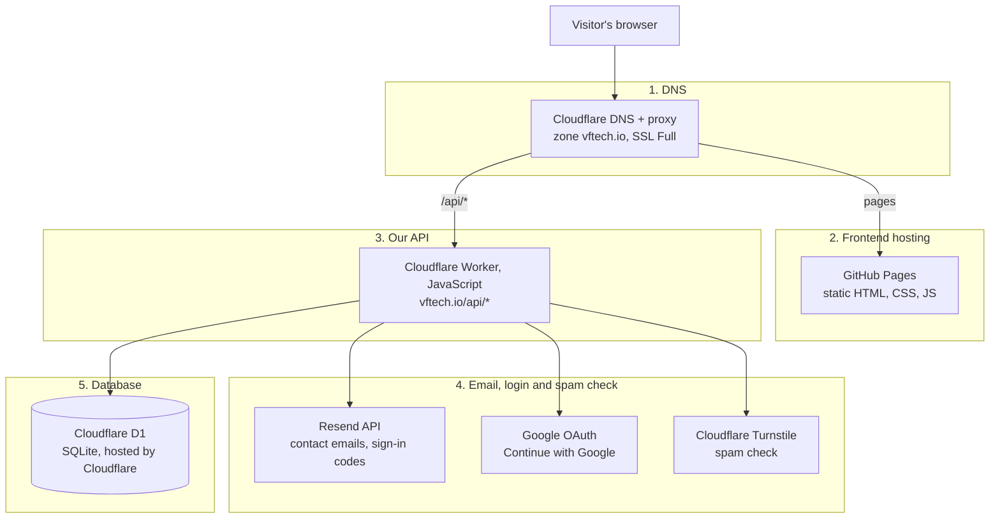

# vftech.io architecture

_Last updated: 29 Oct 2026. No keys or passwords here, only where they live._

Plain HTML site on GitHub Pages, with a Cloudflare Worker behind `/api/*` for the contact form and customer accounts.

## Tech stack

A visit goes top to bottom, one layer at a time. vftech.io does **not** use Supabase: login, contact and the database all run on our own Cloudflare Worker and Cloudflare D1.

| Layer | Technology | Hosted on | Used for |
|---|---|---|---|
| 1. DNS | Cloudflare DNS, proxied | Cloudflare | Points vftech.io at the site and sends `/api/*` to the Worker |
| 2. Frontend | Plain HTML, CSS, JavaScript | GitHub Pages (`VFAssociates/vftech.io`) | Every page and the 9 alternate designs |
| 3. Our API | Cloudflare Worker (JavaScript) | Cloudflare | Contact form, customer login, sessions, request history |
| 4. Email | Resend API, from noreply@vftech.io | Resend | Contact requests to admin@ and kevinvf@, sign-in codes |
| 4. Login | Email code (built in) + Google OAuth | Worker + Google Cloud project VF Tech | Customer accounts, no passwords stored |
| 4. Spam check | Cloudflare Turnstile | Cloudflare | Contact form and sign-in |
| 5. Database | Cloudflare D1 (SQLite) | Cloudflare | Customers, sessions, contact requests |
| Mailboxes | Google Workspace | Google | Company email; MX, SPF, DKIM, DMARC in the same Cloudflare zone |

**Adding our own APIs or database later** (Railway or similar): they would slot in at layer 3 and layer 5. The Worker can call another API, and D1 can stay or be replaced by a hosted Postgres.

The Worker also runs a nightly cleanup at 03:17 UTC (expired codes, sessions, rate limits). Source code is in `VFTechLLC/VFTECH`; the **Deploy to live site** Action (run by hand) builds it into GitHub Pages.

## Site map

- **Home** `/`
  - Website rebuilds `/websites.html`
  - AI integration `/ai.html`
  - Advisory `/advisory.html`
  - How we work `/process.html`
  - About `/about.html`
  - Contact `/contact.html`: request form → Worker → email to admin@ and kevinvf@
  - Customer area
    - Features and pricing `/features.html`: 3 monthly plans, 5 build packages
    - Customer account `/account.html`: email code or Google sign-in, request history
  - Founder (external link)
  - Page not found `/404.html`
- **Alternate designs** `/design-2/` … `/design-10/`: same pages in other styles, hidden from search. `/design-1/` forwards to the main site.
- **Site guide chatbot**: runs in the browser from a local knowledge file and never sends questions anywhere.

## Worker API

| Method | Route | What it does |
|---|---|---|
| GET | `/api/config` | Which forms and sign-in options are switched on |
| GET | `/api/prices` | Plan and package catalog |
| POST | `/api/contact` | Saves a contact request and emails it |
| POST | `/api/auth/request-code` | Emails a 6-digit sign-in code |
| POST | `/api/auth/verify-code` | Checks the code, starts a session |
| GET | `/api/auth/google/start`, `/api/auth/google/callback` | Google sign-in |
| GET | `/api/session` | Who is signed in |
| GET | `/api/account/requests` | The customer's past requests |
| POST | `/api/auth/logout` | Ends the session |

## What happens when…

**Someone sends the contact form**
1. The page loads `services-config.js` from the Worker, which switches the form on.
2. The visitor fills it in and passes the Turnstile check.
3. The Worker verifies the check, rate-limits by IP and saves the request in D1.
4. Resend emails it from noreply@vftech.io to admin@ and kevinvf@, reply-to set to the visitor.
5. The visitor sees "Thanks, your request was sent."

**A customer signs in with an email code**
1. They enter name and email and pass Turnstile.
2. The Worker emails a 6-digit code (valid 10 minutes, 5 tries).
3. The code is checked; a customer record is created on first sign-in.
4. A 7-day session cookie is set and their past requests are shown.

**A customer signs in with Google**
1. "Continue with Google" opens `/api/auth/google/start`, which sends them to Google.
2. Google returns them to `/api/auth/google/callback`.
3. The Worker confirms the sign-in with Google and accepts only a verified email.
4. Same customer record and session as email sign-in, so both methods reach one account.

## Where to change things

| To change | Go to |
|---|---|
| Page text, design | `site/` (or `design-N/`) in this repo. Merge to main, then run the **Deploy to live site** Action by hand. |
| Form and account logic | `backend/worker.js`, deployed with `npx wrangler deploy --config backend/wrangler.jsonc` |
| Settings and secrets | Cloudflare → Workers → `vftech-client-services` → Settings → Variables and secrets |
| Who gets contact emails | Worker variable `CONTACT_TO` (comma-separated) |
| DNS | Cloudflare, account Admin@vftech.io, zone `vftech.io` (registrar still IONOS) |
| Sending email | Resend team `vftech`, domain vftech.io verified |
| Google sign-in | Google Cloud project `VF Tech` → Google Auth Platform → Clients |
| Customer data | Cloudflare D1 `vftech-clients`: customers, sessions, contact requests |

## Accounts and owners

| Service | Account |
|---|---|
| Source code | GitHub organization `VFTechLLC` |
| Live site repo | GitHub `VFAssociates` |
| DNS, Worker, D1, Turnstile | Cloudflare, Admin@vftech.io's Account |
| Outgoing email | Resend team `vftech` (admin@vftech.io) |
| Google sign-in | Google Cloud org `vftech.io`, project VF Tech |
| Company mailboxes | Google Workspace |
| Registrar | IONOS (transfer to Cloudflare in progress) |

## Open items

- Subscriptions and payments: on hold (Stripe or the bank's billing system, to be decided).
- `account.html` still has old "until live services are enabled" wording.
